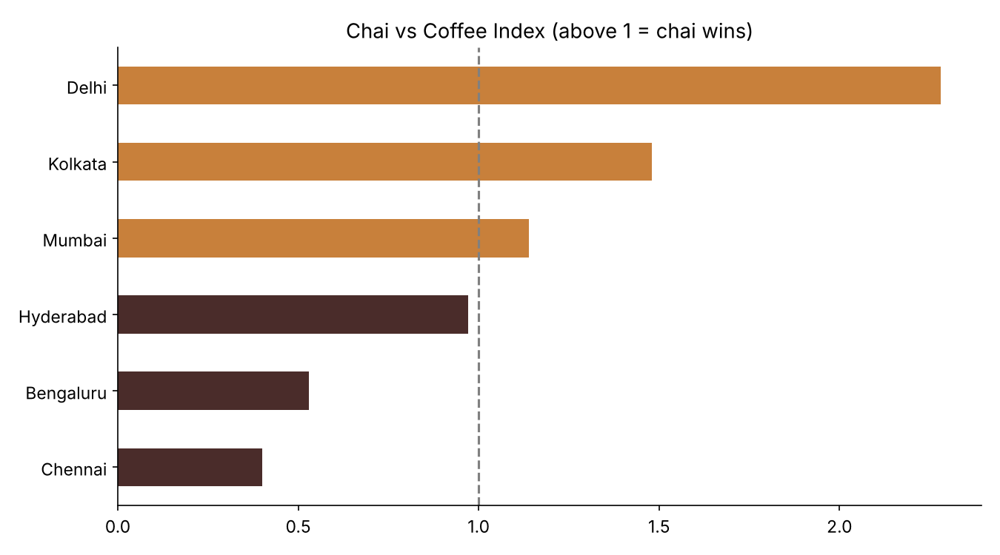
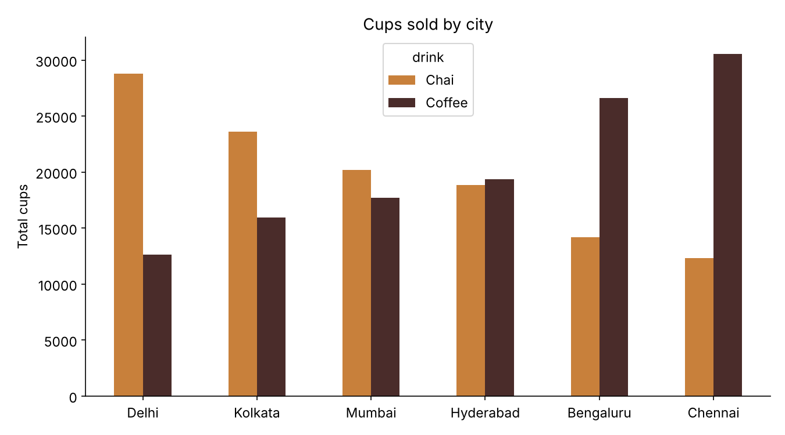
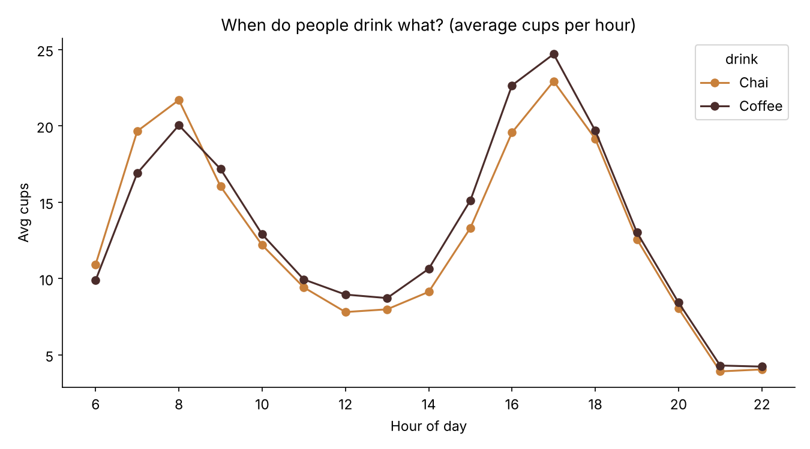
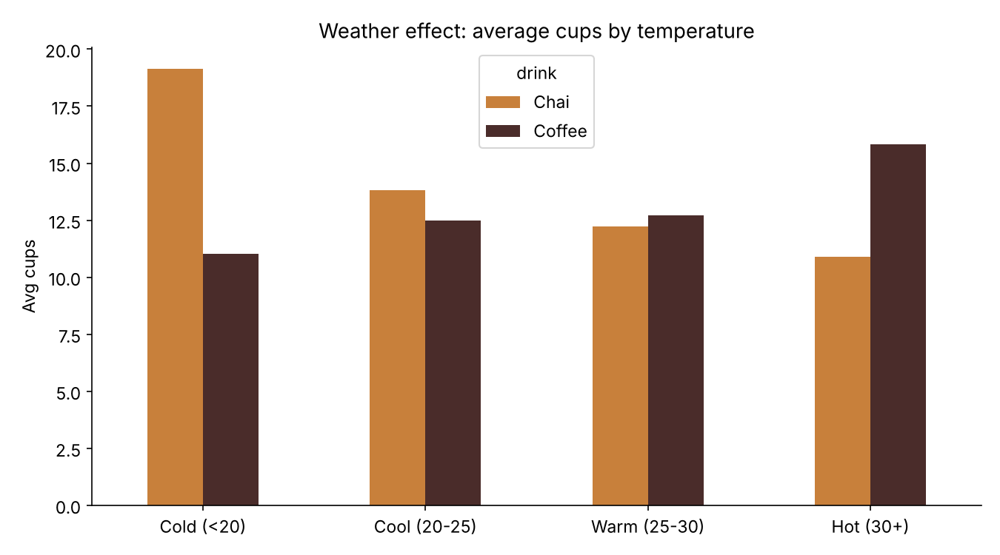

# ☕ The Chai vs Coffee Index

> Which drink wins India's cities, and what decides it: the hour, the weather, or the city itself?

I built a simple **Chai vs Coffee Index** (chai cups ÷ coffee cups). Above 1, chai wins. Below 1, coffee wins.

> **Note:** The data is **simulated** for learning and portfolio purposes. It is not real sales data.

## Key findings
| Finding | Result |
|---|---|
| Most chai-loving city | **Delhi** (index 2.28) |
| Most coffee-loving city | **Chennai** (index 0.40) |
| Closest to a tie | **Hyderabad** (index 0.97) |
| Cold weather (<20°C) | Chai sells ~19 cups/hour vs ~11 for coffee |
| Hot weather (30°C+) | Coffee sells ~16 cups/hour vs ~11 for chai |
| Revenue | Coffee earns ~2.8x more than chai because it costs more per cup |

## Charts





## What I did
1. **Generated** a dataset of ~18k hourly records across 6 cities over 90 days (`generate_data.py`).
2. **Cleaned** it: removed duplicate rows and filled missing temperatures with each city's median.
3. **Analyzed** it with Pandas: pivot tables, time-of-day patterns, temperature bands, revenue.
4. **Visualized** the results with Matplotlib.

## Run it yourself
```bash
pip install -r requirements.txt
python generate_data.py   # creates chai_coffee_sales.csv
python analysis.py        # prints insights and saves charts
```

## Tools
Python · Pandas · NumPy · Matplotlib

## Ideas to extend
- Plug in real sales or survey data
- Add a rainy-day vs sunny-day comparison
- Build a dashboard with Streamlit
